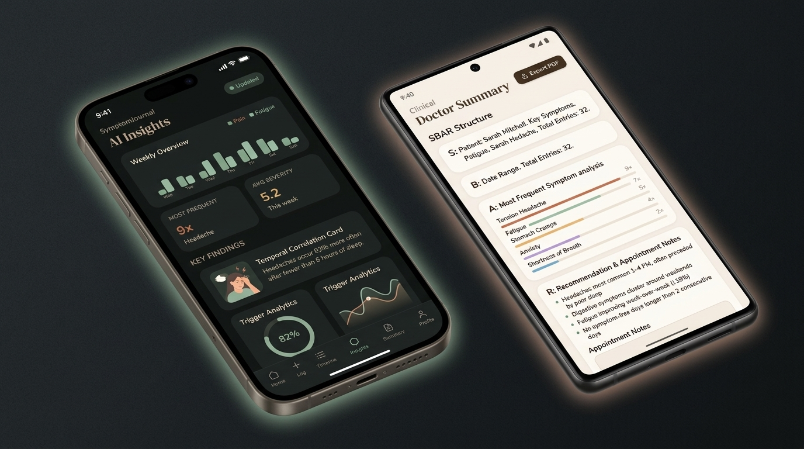
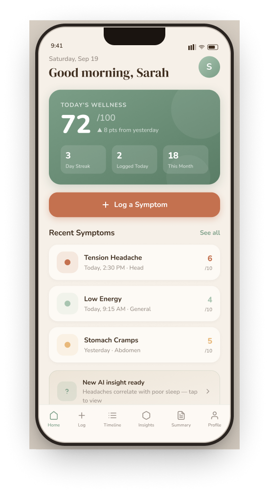
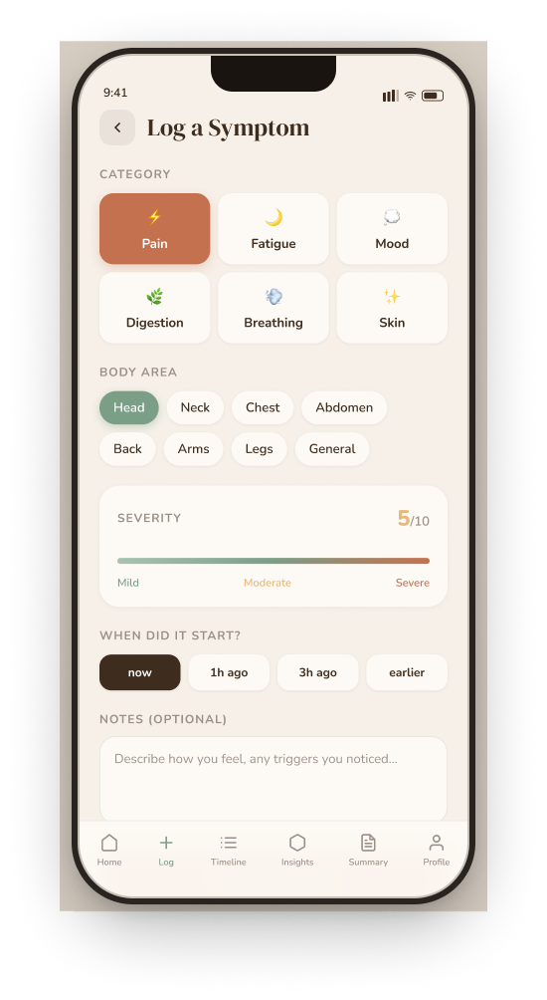
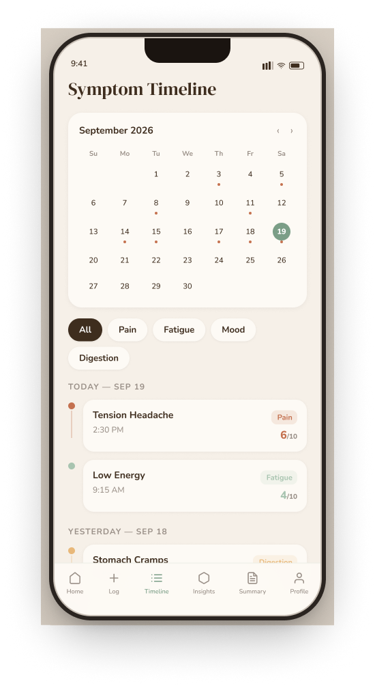
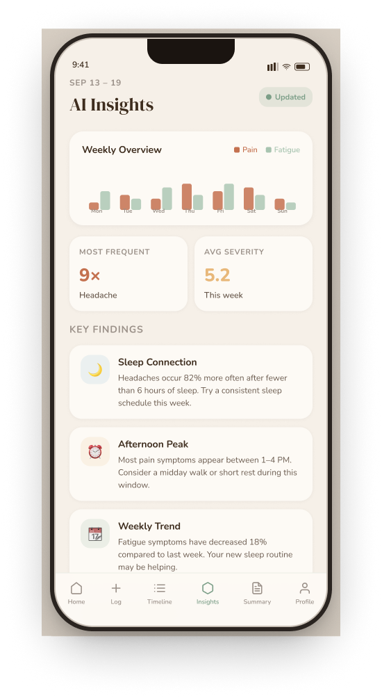
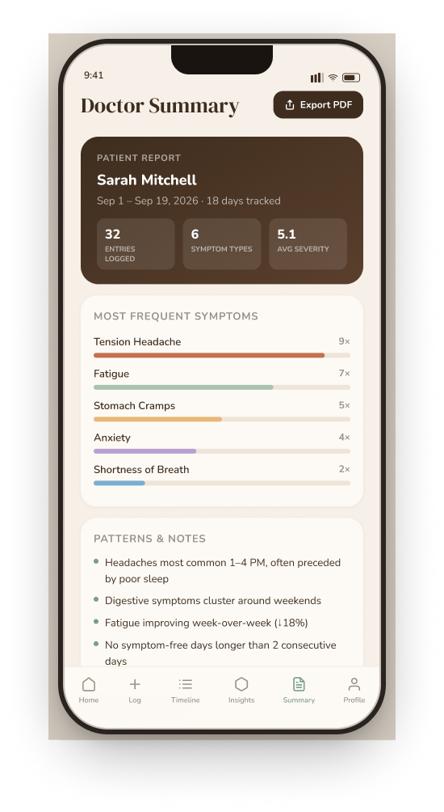
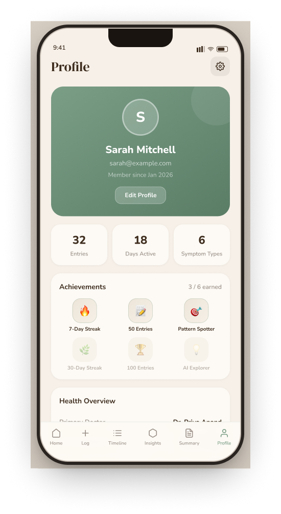

# SymptomJournal 🌿
> *"Log it calmly. Understand it clearly. Talk to your doctor with confidence."*

[](https://github.com/FrancoisleRouxDev/SymptomJournal/releases)
[](frontend/src/__tests__)
[-000020?style=for-the-badge&logo=expo)](https://expo.dev)
[](https://symptomjournal.onrender.com/docs)
[](https://supabase.com)
[]()

A cross-platform mobile health companion engineered to replace the anxiety of Googling symptoms with calm, structured self-awareness. Users log their physical and emotional symptoms in seconds, customize anatomical body regions and triggers, discover temporal correlations powered by NVIDIA NIM AI, and export clinical SBAR doctor summaries directly to PDF for medical appointments.

<p align="center">
  
</p>

---

## Quick Links & Live Deployments

| Resource | Link | Description |
|:---|:---|:---|
| **GitHub Releases (v1.0.3)** | [**SymptomJournal Releases**](https://github.com/FrancoisleRouxDev/SymptomJournal/releases) | Latest release notes, changelog, and standalone build binaries |
| **Android APK Build** | [**Download APK (v1.0.3)**](https://github.com/FrancoisleRouxDev/SymptomJournal/releases) | Standalone installable Android build with brand icons & splash |
| **iOS Simulator Build** | [**iOS Simulator (.tar.gz)**](https://expo.dev/artifacts/eas/evplY85VchJ5j7K3TtDT6uXIu1fE2h_BfyZBJYh9l9s.tar.gz) | Apple iOS Simulator build for Appetize.io or Xcode Simulator |
| **Cloud API (Production)** | [**symptomjournal.onrender.com**](https://symptomjournal.onrender.com) | Production FastAPI backend hosted on Render |
| **Interactive API Docs** | [**Swagger UI Documentation**](https://symptomjournal.onrender.com/docs) | Interactive OpenAPI testing console with auth & analysis routes |
| **Presentation Script** | [**Presentation Script**](docs/MILESTONE_2_PRESENTATION_SCRIPT.md) | Demo walkthrough & rubric defense |
| **Technical Documentation** | [**Technical Report**](docs/MILESTONE_2_DOCUMENTATION.md) | In-depth architecture, data schemas, and risk mitigation |

---

## System Architecture

```
┌────────────────────────────────────────────────────────┐
│             React Native (Expo SDK 57)                 │
│   • Expo Router (Tabs & Stacks)   • Lucide Icons       │
│   • Light & Dark Theme System     • Dynamic Text Scale │
│   • Custom Triggers & Body Areas  • Print / PDF Export │
│   • Persistent Session (AsyncStorage + AppState)       │
└───────────┬────────────────────────────────┬───────────┘
            │                                │
      Supabase Auth                     JWT Bearer Auth
     (ES256 / HS256)                   (Axios Interceptor)
            │                                │
            ▼                                ▼
┌───────────────────────┐        ┌───────────────────────┐
│  Supabase PostgreSQL  │        │   FastAPI (Python)    │
│  • users              │◄───────┤   • /symptoms         │
│  • symptom_logs       │ (CRUD) │   • /analysis         │
│  • Row-Level Security │        │   • /auth (Swagger)   │
└───────────────────────┘        └───────────┬───────────┘
                                             │
                                     Secure Server Key
                                             ▼
                                 ┌───────────────────────┐
                                 │      NVIDIA NIM       │
                                 │  Llama 3.3 70B / 3.2  │
                                 │  • Pattern Discovery  │
                                 │  • Clinical SBAR Summ │
                                 │  • Safe Rx Assistant  │
                                 └───────────────────────┘
```

---

## Core Feature Highlights

### 1. Granular Symptom Logging & Customization
* **Rapid 15-second entry:** 6 core categories (*Pain, Fatigue, Mood, Digestion, Breathing, Skin*) with specialized subcategories and emoji cues.
* **1–10 Severity & Onset:** Precise sliders with visual color transitions and time presets (*Morning, Afternoon, Evening, Night*).
* **Custom Anatomical Areas:** Add custom body areas grouped under intuitive parent regions (*Head, Neck, Torso, Back, Arms, Legs, Other*).
* **Custom Lifestyle Triggers:** Create and save personal triggers (*e.g., "Screen Glare", "Dehydration", "Late Coffee"*) with local persistence.

### 2. Complete Dark & Light Mode System
* **Bespoke Palette:** Calming Deep Slate dark canvas (`#121614`), warm element cards (`#1A211D`), sage accents (`#8BAE97`), and crisp contrast text (`#EBE3D7`).
* **Instant Toggle:** Accessible via the Quick Switch on the Profile screen or inside Settings, automatically updating all tabs, modals, and navigation stacks.

### 3. Accessibility & Dynamic Text Scaling
* **User-Selectable Sizing:** Choose between *Small (85%)*, *Medium (100%)*, *Large (115%)*, and *Extra Large (130%)*.
* **Global Font Scaling:** Scales headings, body text, badges, and button labels dynamically for maximum legibility.

### 4. AI Pattern Recognition & Insights
* **Multi-Entry Synthesis:** Automatically evaluates trends once $\ge 3$ logs are recorded.
* **Correlations Detected:** Temporal clustering (*"Headaches frequently occur between 3 PM – 6 PM"*), trigger associations (*"Poor sleep correlates with 75% of fatigue spikes"*), and calm lifestyle recommendations.
* **Zero Jitter:** Shimmer skeleton loaders provide smooth transitions during inference.

### 5. AI Medication & Health Assistant
* **Safe Clinical Guardrails:** Conversational assistant answering questions regarding over-the-counter medications, interactions, and symptom management.
* **Strict Non-Diagnostic Disclaimer:** Explicit reminders ensuring users consult their physician or pharmacist for medical treatment.

### 6. Clinical Doctor Summary & PDF Export
* **SBAR Format:** Formats logged history into a physician-aligned brief (*Situation, Background, Assessment, Recommendation*).
* **Publication-Grade Print Layout:** High-contrast typography, distribution tables, symptom frequency percentages, patient details, and physician sign-off line.
* **Native System Share & Print:** One-tap export via `expo-print` and `expo-sharing` on iOS, Android, and Web.

### 7. Physician Profile Management
* **Editable Doctor Details:** Track your attending physician's name, primary clinic, and tracked chronic conditions with quick modal editing.
* **Dual-Sync:** Instant local caching via `AsyncStorage` paired with cloud backup to Supabase `user_metadata`.

<p align="center">
  
</p>

### 📸 Core Screens & Visual Walkthrough

| Home Dashboard | Log a Symptom | Timeline & History |
|:---:|:---:|:---:|
|  |  |  |
| **Wellness Overview & Quick Actions** | **Severity Slider & Body Selection** | **Chronological Logs & Filter Badges** |

| AI Correlation Insights | Clinical Doctor Summary | User & Health Profile |
|:---:|:---:|:---:|
|  |  |  |
| **Temporal Patterns & Trigger Links** | **SBAR Briefing & PDF Export** | **Physician Details & Dark Mode Toggle** |

---

## Design System & Brand Identity

The interface balances medical clarity with calming organic aesthetics:

| Token | Light Theme | Dark Theme | Purpose |
|:---|:---|:---|:---|
| **Canvas** | `#F6F0E8` (Warm Linen) | `#121614` (Deep Slate) | Screen background |
| **Card / Surface** | `#FDFAF5` (Off-white) | `#1A211D` (Muted Slate) | Elevated containers & cards |
| **Primary Accent** | `#5A7D66` (Sage Dark) | `#8BAE97` (Sage Glow) | Active buttons, tabs & badges |
| **Secondary Accent**| `#C86D51` (Terracotta) | `#D97A5C` (Warm Rust) | High-severity indicators |
| **Headings** | `#3E2D1E` (Deep Bark) | `#EBE3D7` (Ivory Soft) | DM Serif Display headers |
| **Body Text** | `#6A5A4E` (Muted Soil) | `#B3AAA0` (Warm Grey) | Nunito regular / medium text |
| **Borders** | `#E8DFD1` | `#2D3830` | Structural dividers & chip outlines |

---

## Testing & Verification

SymptomJournal enforces automated test coverage across both frontend and backend layers:

### Frontend Unit & Integration Tests (Jest)
```powershell
cd frontend
npm test
```
* **54 Tests Passing** across 7 test suites:
  * `auth.test.ts` — Session recovery, authentication flows, and profile updates.
  * `api.test.ts` — Axios interceptors, JWT attachment, and error handling.
  * `pdf-export.test.ts` — Clinical HTML generation, patient headers, and native share dialogs.
  * `SkeletonLoader.test.tsx` — Shimmer loading state animations across tab views.
  * `symptom-validation.test.ts` — Category bounds, severity constraints (1–10).
  * `theme.test.ts` — Semantic tokens, contrast levels, and theme provider state.
  * `components.test.tsx` — Custom typography and themed wrappers.

### Backend Unit & Integration Tests (pytest)
```powershell
cd backend
.\.venv\Scripts\pytest
```
* **49 Tests Passing** across 4 test suites:
  * `test_analysis.py` — SBAR summary generation, trend calculation, and pattern recognition.
  * `test_auth.py` — Supabase JWT verification (`ES256` / `HS256`) and profile auto-sync.
  * `test_symptoms.py` — Input validation (Pydantic constraints) and CRUD logic.
  * `test_ai_service.py` — LLM mocking, JSON fence stripping, and fallback recovery.

**Total Automated Coverage: 103 Passing Tests**

---

## Local Development Setup

### Prerequisites
* **Node.js** $\ge 18$
* **Python** $\ge 3.11$
* **Expo Go** on Android/iOS (or Android Emulator / iOS Simulator)

### 1. Clone Repository
```bash
git clone https://github.com/FrancoisleRouxDev/SymptomJournal.git
cd SymptomJournal
```

### 2. Backend Setup (FastAPI)
```bash
cd backend
python -m venv .venv
.\.venv\Scripts\activate   # On Linux/macOS: source .venv/bin/activate
pip install -r requirements.txt
uvicorn main:app --reload --port 8000
```
*Backend Swagger Docs accessible at: `http://localhost:8000/docs`*

### 3. Frontend Setup (React Native / Expo)
```bash
cd ../frontend
npm install
npm start
```
* Scan the terminal QR code with **Expo Go** (Android) or the **Camera app** (iOS).
* Press `w` to run on **Web** (supports Chrome Device Emulation).
* Press `a` to run on a connected **Android Emulator / Device**.

### 4. Cloud Builds (EAS)
```powershell
# Build standalone Android APK
npx eas-cli build -p android --profile preview

# Build iOS Simulator bundle (for Appetize.io or local Mac simulator)
npx eas-cli build -p ios --profile preview-simulator
```

---

## Project Roadmap & Status

- [X] **Phase 1 — Setup & Scaffolding** (Brand design tokens, typography, navigation skeleton)
- [X] **Phase 2 — Auth & Symptom Logging** (Supabase Auth, category grid, severity sliders)
- [X] **Phase 3 — AI Integration via FastAPI** (NVIDIA NIM, pattern detection, safety guardrails)
- [X] **Phase 4 — Core Features & Screens** (Timeline, Doctor Summary, Medication Chatbot, Profile)
- [X] **Phase 5 — Accessibility & Theming** (Complete Dark Mode, dynamic text sizing, custom triggers & body areas)
- [X] **Phase 6 — Clinical Export & Hardening** (Redesigned SBAR PDF, doctor info editor, 103 passing tests)
- [X] **Phase 7 — Multi-Platform Releases** (Render cloud backend, Android APK v1.0.3, iOS Simulator build)
- [ ] **Phase 8 — Qualitative User Testing** (5 peer usability evaluations & feedback analysis)

---

## Academic Module
**Module:** Interactive Development 300 (DV300) – Theme 4: AI-Driven Application  
**Institution:** The Open Window Institute  
**Student:** Francois le Roux (231256)  
**Milestone Date:** Wednesday, 14 October 2026 | **Final Submission:** 28 October 2026
