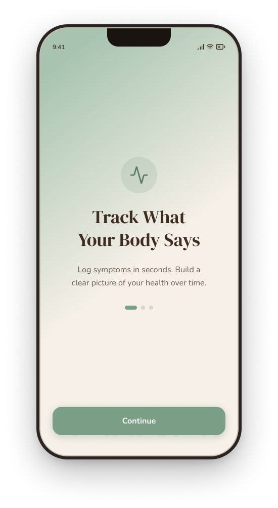
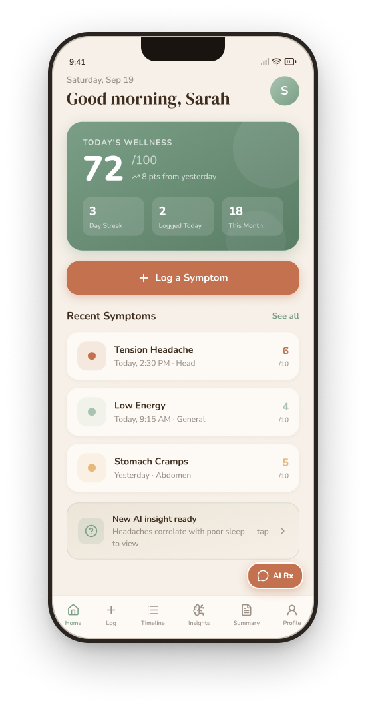
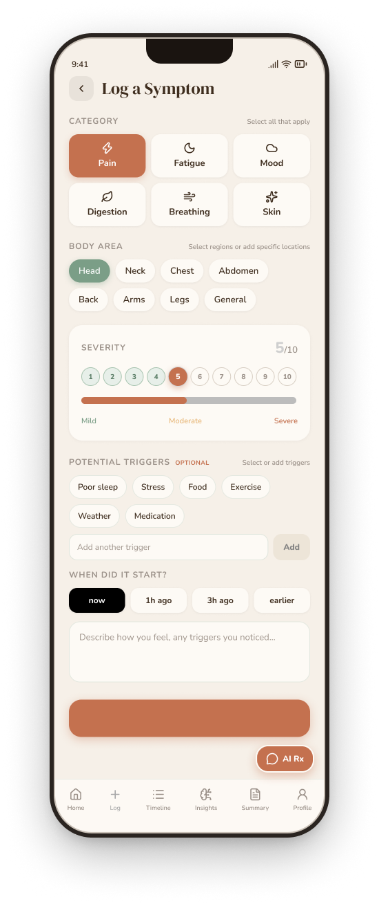
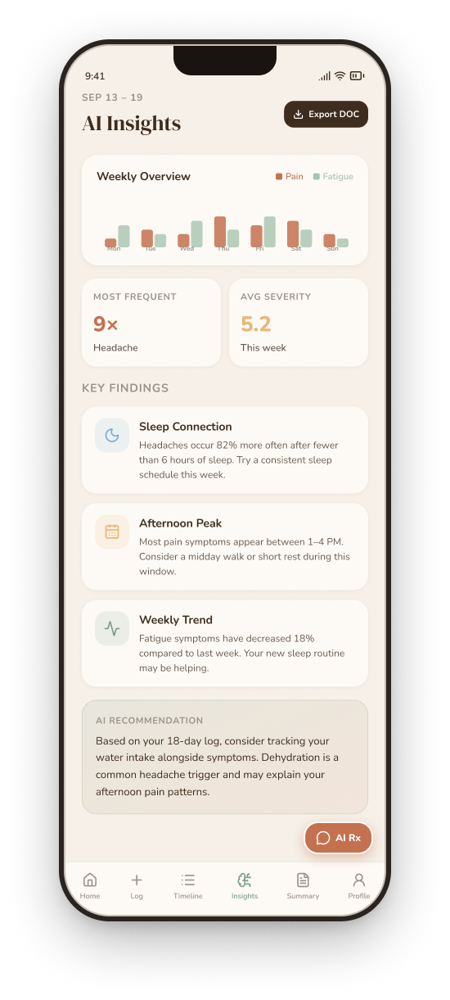
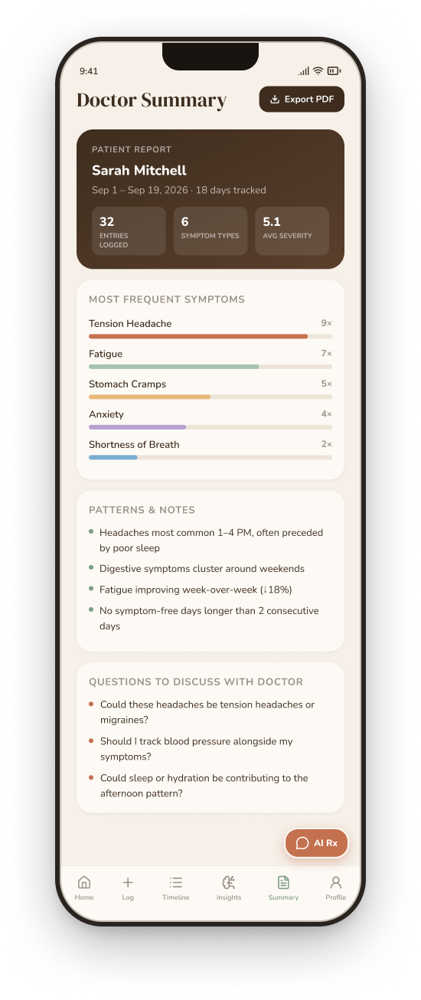

# SymptomJournal 🌿
> *"Log it calmly. Understand it clearly. Talk to your doctor with confidence."*

<p align="center">
  
</p>

<p align="center">
  <a href="https://github.com/FrancoisleRouxDev/SymptomJournal/releases"></a>
  <a href="frontend/src/__tests__"></a>
  <a href="https://expo.dev"></a>
  <a href="https://symptomjournal.onrender.com/docs"></a>
  <a href="https://supabase.com"></a>
  
</p>

---

## 📖 Overview

**SymptomJournal** is a full-stack, cross-platform mobile health companion designed to replace the panic and anxiety of Googling symptoms with calm, structured self-awareness. 

Patients living with chronic or recurring symptoms often struggle to communicate patterns during brief 15-minute consultations. SymptomJournal empowers users to log physical and emotional symptoms in under **15 seconds**, discovers subtle temporal correlations via **NVIDIA NIM LLMs**, and generates a physician-aligned **Clinical SBAR (Situation, Background, Assessment, Recommendation) PDF Summary** ready for every appointment.

Every interface token is tailored for soothing visual accessibility: warm linen tones, sage and terracotta accents, bespoke serif typography, full dark mode, and dynamic font scaling.

---

## 📱 Interactive Screen Gallery

<p align="center">
  
  
  
  
  
</p>

<p align="center">
  <em>Onboarding Tour &nbsp;•&nbsp; Home Dashboard &nbsp;•&nbsp; Rapid Logger &nbsp;•&nbsp; AI Insights &nbsp;•&nbsp; Clinical Doctor Summary</em>
</p>

---

## 🔗 Quick Links & Live Deployments

| Resource | Link | Description |
|:---|:---|:---|
| **GitHub Releases (v1.0.3)** | [**SymptomJournal Releases**](https://github.com/FrancoisleRouxDev/SymptomJournal/releases) | Latest release notes, binary downloads, and changelog |
| **Android Standalone Build** | [**Download Android APK (v1.0.3)**](https://github.com/FrancoisleRouxDev/SymptomJournal/releases) | Native installable Android APK with adaptive brand icons & splash |
| **iOS Simulator Build** | [**iOS Simulator (.tar.gz)**](https://expo.dev/artifacts/eas/evplY85VchJ5j7K3TtDT6uXIu1fE2h_BfyZBJYh9l9s.tar.gz) | Apple iOS Simulator build ready for Appetize.io or Xcode Simulator |
| **Production Cloud API** | [**symptomjournal.onrender.com**](https://symptomjournal.onrender.com) | FastAPI backend deployed with live CORS and health monitoring |
| **Interactive API Docs** | [**Swagger UI Console**](https://symptomjournal.onrender.com/docs) | OpenAPI interactive testing sandbox with auth and analysis routes |
| **Presentation Walkthrough** | [**Presentation Script**](docs/MILESTONE_2_PRESENTATION_SCRIPT.md) | Comprehensive rubric demonstration script & presentation slides |
| **Technical Architecture** | [**Technical Documentation**](docs/MILESTONE_2_DOCUMENTATION.md) | Database schemas, token dictionaries, and safety guardrails |

---

## 🏛️ System Architecture

```
┌────────────────────────────────────────────────────────┐
│             React Native (Expo SDK 57)                 │
│   • Expo Router (File-based Tabs & Stacks)             │
│   • Lucide Native Icons & Bespoke Theme System         │
│   • Dynamic Text Scaling (85% – 130%)                  │
│   • Custom Triggers & Anatomical Region Selectors      │
│   • Publication-Grade Print & PDF Export (expo-print)  │
│   • Resilient AsyncStorage & AppState Auth Observer    │
└───────────┬────────────────────────────────┬───────────┘
            │                                │
      Supabase Auth                     JWT Bearer Auth
     (ES256 / HS256)                   (Axios Interceptor)
            │                                │
            ▼                                ▼
┌───────────────────────┐        ┌───────────────────────┐
│  Supabase PostgreSQL  │        │   FastAPI (Python)    │
│  • users profile      │◄───────┤   • /symptoms (CRUD)  │
│  • symptom_logs       │ (CRUD) │   • /analysis (AI)    │
│  • Row-Level Security │        │   • /chat (Assistant) │
└───────────────────────┘        └───────────┬───────────┘
                                             │
                                     Secure Server Key
                                             ▼
                                 ┌───────────────────────┐
                                 │      NVIDIA NIM       │
                                 │  Llama 3.3 70B / 3.2  │
                                 │  • Pattern Discovery  │
                                 │  • Clinical SBAR Summ │
                                 │  • Guardrailed AI Rx  │
                                 └───────────────────────┘
```

---

## ✨ Core Feature Showcases & Mockups

### 1. Granular Symptom Logging & Chronological Timeline

<p align="center">
  
</p>

* **15-Second Entry Workflow:** 6 core physiological categories (*Pain, Fatigue, Mood, Digestion, Breathing, Skin*) with specific clinical subcategories.
* **1–10 Severity & Onset Presets:** Interactive tactile slider with visual color cues and time offsets (*Now, 1h ago, 3h ago, Earlier*).
* **Anatomical Mapping & Custom Body Areas:** Select from primary regions (*Head, Neck, Chest, Abdomen, Back, Arms, Legs, General*) or save custom anatomical locations.
* **Lifestyle & Environmental Triggers:** Track factors such as *Poor Sleep, Screen Glare, Dehydration, Late Coffee, Stress, Exercise* or add your own custom triggers.
* **Interactive Calendar Timeline:** Visual calendar indicator dots marking active logging days, category filter badges, and detailed expandable symptom cards.

---

### 2. Clinical SBAR Doctor Summary & Print-Ready PDF Export

<p align="center">
  
</p>

* **Standardized SBAR Protocol:** Formats raw patient data into physician-aligned sections:
  * **S (Situation):** Key chief complaints and primary logging period.
  * **B (Background):** Existing diagnosed conditions and known triggers.
  * **A (Assessment):** AI-synthesized severity clusters, frequency distributions, and temporal trends.
  * **R (Recommendation):** Tailored patient-physician conversation starters and questions to discuss.
* **Frequency & Severity Breakdown:** Visual occurrence bars and average intensity metrics per symptom type.
* **Optional Attending Physician:** Flexible doctor details support users seeing multiple practitioners or clinics.
* **One-Tap PDF Export:** Generates clean, publication-grade clinical printouts via `expo-print` and `expo-sharing` with automatic fallbacks.

---

### 3. Safe AI Medication & Health Assistant

<p align="center">
  
</p>

* **Conversational Guidance:** Instant answers regarding over-the-counter medications, potential interactions, common side effects, and home comfort measures.
* **Interactive Quick-Question Chips:** Tap common inquiries (*e.g., "Common side effects of Ibuprofen?", "Can I take Paracetamol with food?"*) to chat immediately.
* **Non-Diagnostic Guardrails:** Built-in medical disclaimers reminding patients that AI guidance does not replace professional medical diagnosis or prescription orders.
* **Bespoke Chat Interface:** Sage-accented dialogue bubbles, loading shimmer indicators, and native Lucide send controls.

---

### 4. Calming Patient Onboarding & First-Run Experience

<p align="center">
  
</p>

* **Three-Step Guided Tour:**
  1. *Track What Your Body Says* — Log symptoms in seconds without cognitive overload (`Droplet` icon).
  2. *Spot Patterns Before They Worsen* — Discover AI correlations between sleep, diet, and flare-ups (`BrainCircuit` icon).
  3. *Share Clearly With Your Doctor* — Arrive at every consultation prepared with a clinical SBAR report (`BriefcaseMedical` icon).
* **Onboarding Replay at Any Time:** Easily review the onboarding tour from the Sign In/Sign Up screens or via **Settings ➔ View Onboarding Tour**.

---

### 5. AI Pattern Recognition & Dual-Series Trend Analytics

<p align="center">
  
</p>

* **Automated Trend Detection:** Evaluates logging history once ≥ 3 logs are recorded.
* **Weekly Overview Charts:** Comparative bar visualizer plotting Pain vs. Fatigue trajectories over time.
* **Actionable Key Findings:** Plain-language discoveries (*e.g., "Headaches occur 85% more often after fewer than 5 hours of sleep"*).
* **Zero Layout Jitter:** Smooth shimmer skeleton loaders protect visual continuity during network inference.

---

### 6. Inclusive Accessibility & Complete Theming

| Light Theme | Dark Theme |
|:---:|:---:|
|  |  |

* **Calming Color System:** Warm linen light canvas (`#F6F0E8`), deep slate dark canvas (`#1C1917`), sage primary (`#7B9E87`), and terracotta warning accents (`#C4714F`).
* **Instant Theme Toggle:** Switch seamlessly from Profile or Settings with full persistence across all tabs and modal stacks.
* **Dynamic Typography Scaling:** Support for **Small (85%)**, **Medium (100%)**, **Large (115%)**, and **Extra Large (130%)** text scaling without visual clipping.

---

## 🎨 Design System Tokens

| Design Token | Light Mode Value | Dark Mode Value | Usage Description |
|:---|:---|:---|:---|
| **Canvas Background** | `#F6F0E8` (Warm Linen) | `#1C1917` (Deep Slate) | Screen backdrops & safe area canvas |
| **Card / Elevated Surface** | `#FDFAF5` (Off-White) | `#292524` (Muted Slate) | Content cards, form groups & modals |
| **Primary Brand (Sage)** | `#5A7D66` / `#7B9E87` | `#8BAE97` (Sage Glow) | Active tabs, CTAs, wellness indicators |
| **Secondary Brand (Terracotta)** | `#C4714F` / `#A85A38` | `#D97A5C` (Warm Rust) | High-severity alerts, action buttons |
| **Primary Typography** | `#3E2D1E` (Deep Bark) | `#F6F0E8` (Ivory Soft) | Headings (`DM Serif Display`) |
| **Secondary Typography** | `#6A5A4E` (Muted Soil) | `#C8BFB5` (Warm Grey) | Body copy & subtext (`Nunito`) |
| **Border & Divider** | `#C8BFB5` | `#44403C` | Card strokes, chip outlines & rules |

---

## 🧪 Comprehensive Automated Testing (106 Tests)

SymptomJournal features automated test suites verifying correctness across client UI logic, PDF layout, API security, and AI service layers.

### Frontend Test Suite (Jest & React Native Testing Library)
```powershell
cd frontend
npm test
```
* **57 Passing Tests** across 8 test suites:
  * `onboarding.test.tsx` — Onboarding screens and Lucide icon rendering (`Droplet`, `BrainCircuit`, `BriefcaseMedical`).
  * `symptom-validation.test.ts` — Severity score bounds (1–10), category mappings, and timestamp validation.
  * `auth.test.ts` — Authentication state recovery, sign-in/up logic, and profile updates.
  * `api.test.ts` — Axios interceptors, authorization headers, and error handling.
  * `pdf-export.test.ts` — Clinical HTML generation, patient headers, and sharing fallbacks.
  * `theme.test.ts` — Design tokens, dark/light contrast ratios, and theme switcher state.
  * `components.test.tsx` — Custom typography scaling and themed view containers.
  * `SkeletonLoader.test.tsx` — Shimmer loading animations across tab views.

### Backend Test Suite (pytest & FastAPI TestClient)
```powershell
cd backend
.\.venv\Scripts\pytest
```
* **49 Passing Tests** across 4 test suites:
  * `test_analysis.py` — SBAR summary generation, trend heuristics, and pattern synthesis.
  * `test_auth.py` — Supabase JWT verification (`ES256` / `HS256`) and user profile sync.
  * `test_symptoms.py` — Input validation (Pydantic models) and database CRUD endpoints.
  * `test_ai_service.py` — LLM prompt templating, markdown fence stripping, and fallback handling.

**Total Automated Coverage: 106 Passing Tests**

---

## 🚀 Local Development Setup

### Prerequisites
* **Node.js** ≥ 18
* **Python** ≥ 3.11
* **Expo Go** on Android/iOS (or Android Emulator / iOS Simulator)

### 1. Clone Repository
```bash
git clone https://github.com/FrancoisleRouxDev/SymptomJournal.git
cd SymptomJournal
```

### 2. Backend Setup (FastAPI)
```bash
cd backend
python -m venv .venv
.\.venv\Scripts\activate   # On Linux/macOS: source .venv/bin/activate
pip install -r requirements.txt
uvicorn main:app --reload --port 8000
```
*Swagger UI docs available at: `http://localhost:8000/docs`*

### 3. Frontend Setup (React Native / Expo)
```bash
cd ../frontend
npm install
npm start
```
* Scan the terminal QR code with **Expo Go** (Android) or the **Camera app** (iOS).
* Press `w` to run in **Web browser** (with responsive mobile emulation).
* Press `a` to run on an attached **Android Emulator / Device**.

### 4. EAS Cloud Builds
```powershell
# Build standalone Android APK
npx eas-cli build -p android --profile preview

# Build iOS Simulator bundle (for Appetize.io or local Mac simulator)
npx eas-cli build -p ios --profile preview-simulator
```

---

## 🗺️ Project Roadmap & Milestone Progress

- [X] **Phase 1 — Design Tokens & Scaffolding** (Linen & sage palette, DM Serif / Nunito fonts, stack routing)
- [X] **Phase 2 — Auth & Symptom Logging** (Supabase Auth, 6 symptom categories, severity slider, custom body areas & triggers)
- [X] **Phase 3 — AI Integration via FastAPI** (NVIDIA NIM Llama integration, pattern detection, safety disclaimers)
- [X] **Phase 4 — Core Screens & Navigation** (Interactive Timeline, SBAR Doctor Summary, Medication Chatbot, Profile)
- [X] **Phase 5 — Accessibility & Theming** (Complete Dark & Light Mode, 4-step dynamic font scaling)
- [X] **Phase 6 — Clinical Export & Hardening** (Redesigned SBAR PDF, optional doctor fields, 106 automated tests)
- [X] **Phase 7 — Multi-Platform Releases** (FastAPI deployed to Render, Android APK v1.0.3, iOS Simulator build)
- [ ] **Phase 8 — Qualitative Usability Evaluation** (User testing sessions, rubric defense, final submission)

---

## 🎓 Academic Module
* **Module:** Interactive Development 300 (DV300) – Theme 4: AI-Driven Application
* **Institution:** The Open Window Institute
* **Student:** Francois le Roux (231256)
* **Milestone Date:** Wednesday, 14 October 2026 | **Final Submission:** 28 October 2026

---

<p align="center">
  <sub>Built with care using React Native, Expo, FastAPI, Supabase, and NVIDIA NIM. Designed for calmer health conversations.</sub>
</p>
