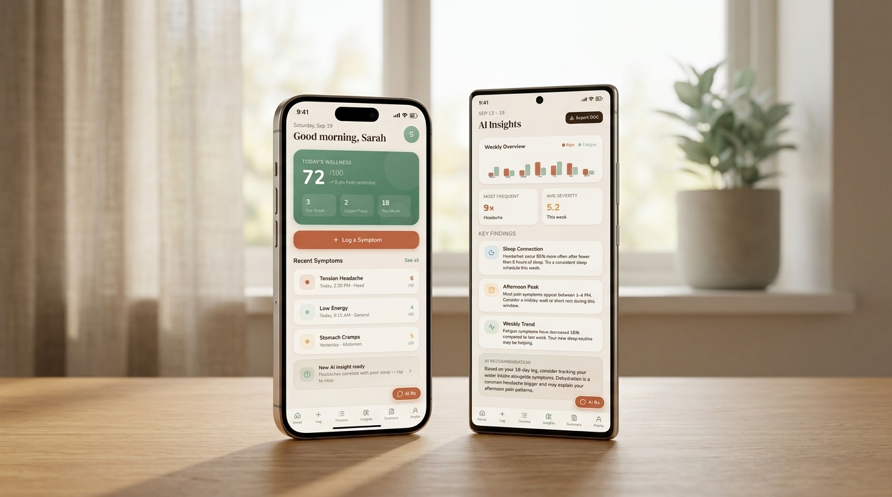
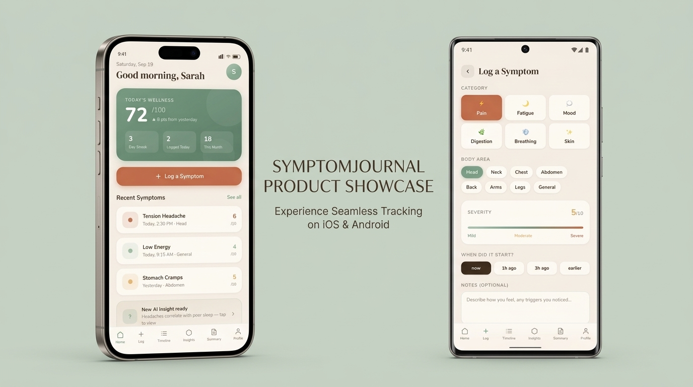
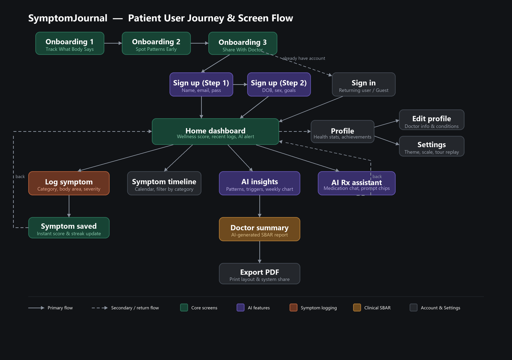
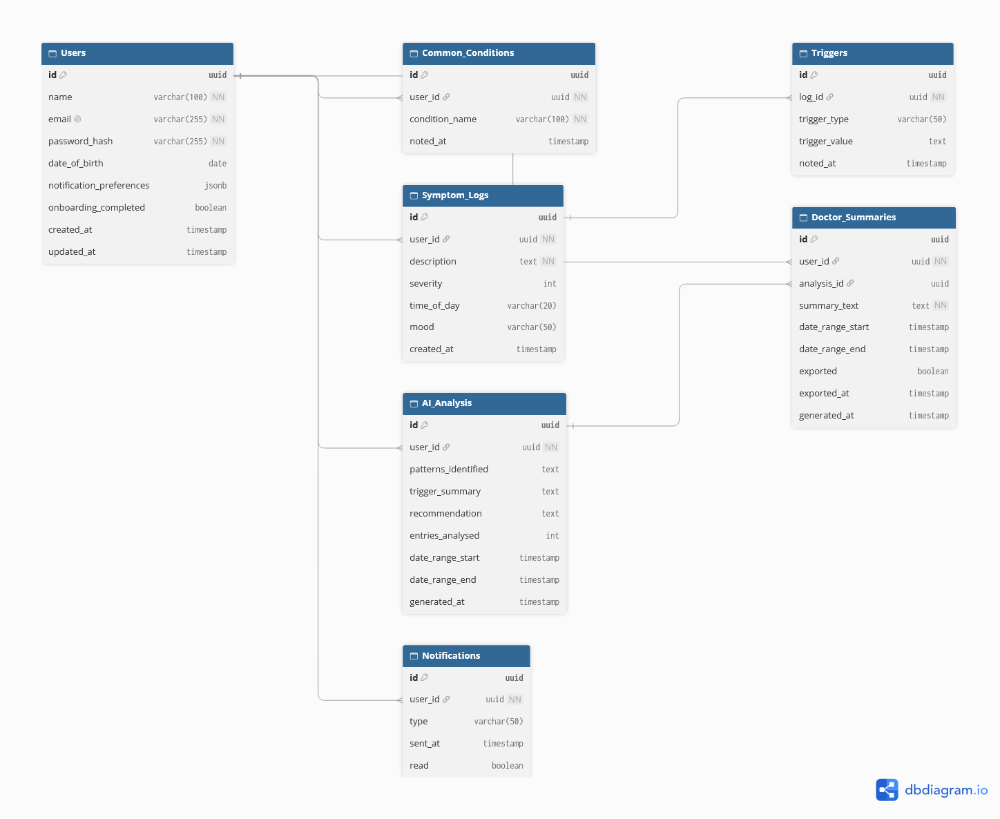
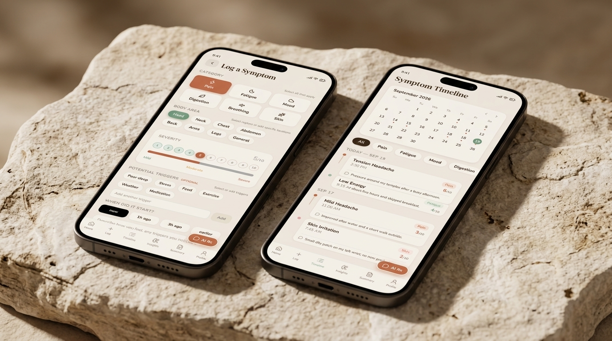
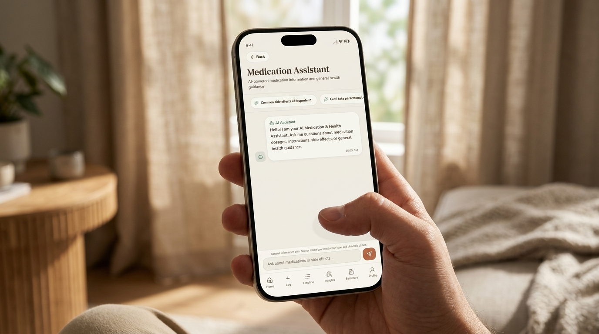
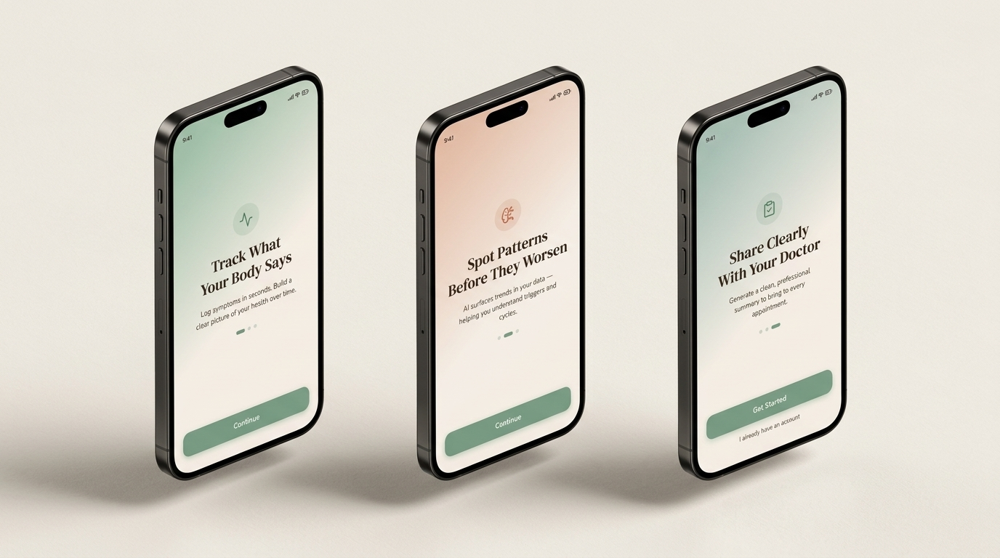
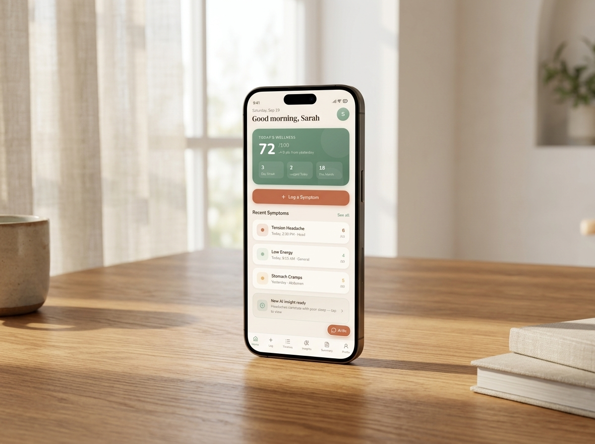
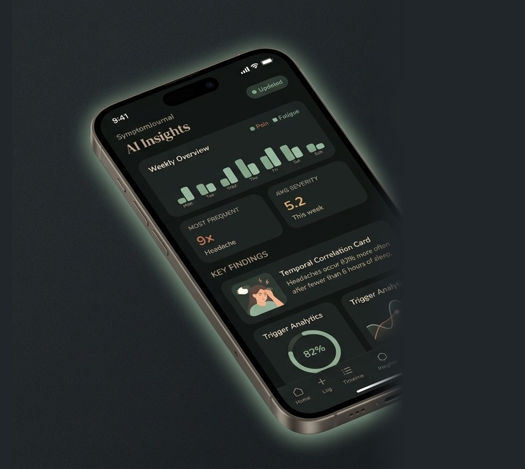

# SymptomJournal
> *"Log it calmly. Understand it clearly. Talk to your doctor with confidence."*

<p align="center">
  
</p>

<p align="center">
  <a href="https://drive.google.com/file/d/1T-G9pcPBQFfmpMDE1VsPNFXUsfRVfK2b/view?usp=sharing"></a>
  <a href="https://github.com/FrancoisleRouxDev/SymptomJournal/releases"></a>
  <a href="#automated-testing"></a>
  <a href="https://expo.dev"></a>
  <a href="https://symptomjournal.onrender.com/docs"></a>
  <a href="https://supabase.com"></a>
  
</p>

---

## Overview

**SymptomJournal** is a full-stack, cross-platform mobile health companion designed to replace the panic and anxiety of Googling symptoms with calm, structured self-awareness.

Patients living with chronic or recurring symptoms often struggle to communicate patterns during brief consultations. SymptomJournal empowers users to log physical and emotional symptoms in under **15 seconds**, discovers subtle temporal correlations via **NVIDIA NIM LLMs**, and generates a physician-aligned **Clinical SBAR (Situation, Background, Assessment, Recommendation) PDF Summary** ready for every appointment.

Every interface token is tailored for soothing visual accessibility: warm linen tones, sage and terracotta accents, bespoke serif typography, full dark mode, and dynamic font scaling.

---

## Presentation Video

<p align="center">
  <a href="https://drive.google.com/file/d/1T-G9pcPBQFfmpMDE1VsPNFXUsfRVfK2b/view?usp=sharing">
    
  </a>
</p>

<p align="center">
  <strong>▶ <a href="https://drive.google.com/file/d/1AC0Uixj7OhL9on8PNMDKNyWhRbKnfbqB/view?usp=sharing">Watch the Presentation Video on Google Drive</a></strong>
</p>

The walkthrough follows a brand-new user from onboarding and sign-up through logging symptoms, the timeline, AI insights, the doctor summary and PDF export, the AI medication assistant, profile, and settings.

---

## Quick Links & Live Deployments

| Resource | Link | Description |
|:---|:---|:---|
| **Demo Video** | [Watch on Google Drive](https://drive.google.com/file/d/1T-G9pcPBQFfmpMDE1VsPNFXUsfRVfK2b/view?usp=sharing) | Full app walkthrough as a brand-new user |
| **GitHub Releases** | [SymptomJournal Releases](https://github.com/FrancoisleRouxDev/SymptomJournal/releases) | Latest release notes, binary downloads, and changelog |
| **Android APK (v1.0.7)** | [Download Android APK](https://github.com/FrancoisleRouxDev/SymptomJournal/releases) | Native installable Android APK with adaptive brand icons & splash |
| **iOS Simulator Build (v1.0.7)** | [iOS Simulator (.tar.gz) on Google Drive](https://drive.google.com/file/d/12JoXY0DjwHH6oY1v2ckVJGk1jnKhxIp-/view?usp=sharing) | Apple iOS Simulator build. Upload the .tar.gz to Appetize.io to run it in a browser, or open it in the Xcode Simulator on a Mac |
<!-- | **Production API** | [symptomjournal.onrender.com](https://symptomjournal.onrender.com) | FastAPI backend deployed with live CORS and health monitoring | -->
| **API Documentation** | [Swagger UI Console](https://symptomjournal.onrender.com/docs) | OpenAPI interactive testing sandbox with auth and analysis routes |
| **Patient User Journey** | [User Journey Map](docs/USER_JOURNEY.md) | Complete end-to-end patient experience map & visual flow diagram |
| **Database ERD** | [Entity Relationship Diagram](docs/ERD-Diagram.png) | PostgreSQL schema diagram with foreign keys and relationships |
| **Database Schema** | [supabase_schema.sql](docs/supabase_schema.sql) | SQL definitions for the Supabase tables |
| **Project Pitch** | [DV300 Project Pitch (PDF)](docs/Francois%20le%20Roux%20231256_DV300_Project_Pitch_Semester%202_Term%204-1.pdf) | Original proposal, problem statement, and scope |

---

## System Architecture

```
┌────────────────────────────────────────────────────────┐
│             React Native (Expo SDK 58)                 │
│   • Expo Router (File-based Tabs & Stacks)             │
│   • Lucide Native Icons & Bespoke Theme System         │
│   • Dynamic Text Scaling (85% – 130%)                  │
│   • Custom Triggers & Anatomical Region Selectors      │
│   • Publication-Grade Print & PDF Export (expo-print)  │
│   • Native Push Notifications (expo-notifications)     │
│   • Resilient AsyncStorage & AppState Auth Observer    │
└───────────┬────────────────────────────────┬───────────┘
            │                                │
      Supabase Auth                     JWT Bearer Auth
     (ES256 / HS256)                   (Axios Interceptor)
            │                                │
            ▼                                ▼
┌───────────────────────┐        ┌────────────────────────┐
│  Supabase PostgreSQL  │        │ FastAPI on Render      │
│  • users profile      │◄───────┤ • /auth (rate-limited) │
│  • symptom_logs       │ (CRUD) │ • /symptoms (CRUD)     │
│  • triggers           │        │ • /analysis/patterns   │
│  • notifications      │        │ • /analysis/summary    │
│                       │        │ • /analysis/chat       │
└───────────────────────┘        └───────────┬────────────┘
                                             │
                                     Secure Server Key
                                             ▼
                                 ┌────────────────────────┐
                                 │       NVIDIA NIM       │
                                 │ Nemotron 3.5 Lightning │
                                 │  • Pattern Discovery   │
                                 │  • Clinical SBAR Summ  │
                                 │  • Guardrailed AI Rx   │
                                 └────────────────────────┘
```

The AI model is `nvidia/nemotron-3.5-lightning-30b-a3b`, with reasoning mode switched off so answers return in seconds. It can be changed with the `NVIDIA_MODEL` environment variable. A scheduled GitHub Action pings `/ping` to keep the free Render instance awake, and the app also wakes the backend on launch and whenever it returns to the foreground.

---

## Patient User Journey & Screen Navigation Flow

SymptomJournal guides patients from initial onboarding and structured daily tracking through to actionable AI correlations and clinical SBAR consultation summaries ([read the in-depth journey specification](docs/USER_JOURNEY.md)):

<p align="center">
  
</p>

### Navigation Structure & Flow Legend

* **Onboarding & Authentication:**
  * **Onboarding 1, 2, 3:** Sequential introductory walkthrough presenting the app's three core value propositions.
  * **Sign Up (Step 1 & 2):** Two-step registration capturing credentials, demographics, and personal health goals.
  * **Sign In:** Returning user session recovery with quick tour replay option.
* **Central Hub:**
  * **Home Dashboard:** Daily wellness score, day streaks, recent symptoms feed, and AI alert nudge.
  * **Profile:** Health statistics and achievements, routing to Edit Profile and Settings.
* **Feature Branches:**
  * **Log Symptom:** 15-second category, severity slider (1–10), body area, and lifestyle triggers → Symptom Saved → returns to Dashboard.
  * **Symptom Timeline:** Visual calendar dot indicators and category filter chips with full log management.
  * **AI Insights:** Weekly trend charts and plain-language temporal findings → Doctor Summary (Clinical SBAR) → Export PDF.
  * **AI Assistant:** Conversational medication chat with interactive prompt chips and safety disclaimers.
  * **Push Notifications:** Configurable daily reminder time picker with native Android channel integration.

---

## Database Architecture & Entity Relationship Diagram

The data layer is managed on **Supabase PostgreSQL** with strict Row-Level Security (RLS) policies ensuring patients can exclusively access and export their own medical history.

<p align="center">
  
</p>

### Relational Schema & Data Dictionary

| Table | Primary Key | Foreign Keys | Key Columns | Purpose |
|:---|:---|:---|:---|:---|
| **`Users`** | `id` (uuid) | — | `name`, `email`, `date_of_birth`, `notification_preferences` (jsonb), `onboarding_completed` | Core patient identity, auth credentials, and notification settings. |
| **`Common_Conditions`** | `id` (uuid) | `user_id` → `Users.id` | `condition_name`, `noted_at` | Pre-existing medical conditions used for clinical background context. |
| **`Symptom_Logs`** | `id` (uuid) | `user_id` → `Users.id` | `description`, `severity` (1–10), `time_of_day`, `mood`, `created_at` | Primary log recording each symptom event, intensity score, and temporal context. |
| **`Triggers`** | `id` (uuid) | `log_id` → `Symptom_Logs.id` | `trigger_type`, `trigger_value`, `noted_at` | Correlated lifestyle and environmental factors (e.g., Poor Sleep, Stress, Weather). |
| **`AI_Analysis`** | `id` (uuid) | `user_id` → `Users.id` | `patterns_identified`, `trigger_summary`, `recommendation`, `entries_analysed` | Cached LLM inference results, temporal trend syntheses, and lifestyle recommendations. |
| **`Doctor_Summaries`** | `id` (uuid) | `user_id` → `Users.id`<br>`analysis_id` → `AI_Analysis.id` | `summary_text` (SBAR), `date_range_start/end`, `exported` (bool) | Physician-ready clinical reports with consultation discussion points and export timestamps. |
| **`Notifications`** | `id` (uuid) | `user_id` → `Users.id` | `type`, `sent_at`, `read` (bool) | In-app reminders for scheduled logging check-ins and new AI pattern alerts. |

---

## Core Feature Showcases

### 1. Granular Symptom Logging & Chronological Timeline

<p align="center">
  
</p>

* **15-Second Entry Workflow:** Six core physiological categories (*Pain, Fatigue, Mood, Digestion, Breathing, Skin*) with specific clinical subcategories.
* **Severity & Onset Presets:** Interactive tactile slider with visual colour cues and time offsets (*Now, 1h ago, 3h ago, Earlier*). The chosen start time is saved as the log time and shown in the user's local timezone.
* **Short Notes:** Optional note with a live character counter (50 characters max).
* **Anatomical Mapping:** Select from primary body regions or save custom anatomical locations.
* **Lifestyle & Environmental Triggers:** Track factors such as *Poor Sleep, Screen Glare, Dehydration, Stress, Exercise* or add custom triggers.
* **Interactive Calendar Timeline:** Visual calendar indicator dots marking active logging days, category filter badges, and expandable symptom cards.

---

### 2. Clinical SBAR Doctor Summary & Print-Ready PDF Export

<p align="center">
  
</p>

* **Standardised SBAR Protocol:** Formats raw patient data into physician-aligned sections:
  * **S (Situation):** Key chief complaints and primary logging period.
  * **B (Background):** Existing diagnosed conditions and known triggers.
  * **A (Assessment):** AI-synthesised severity clusters, frequency distributions, and temporal trends.
  * **R (Recommendation):** Tailored patient–physician conversation starters and discussion questions.
* **Frequency & Severity Breakdown:** Visual occurrence bars and average intensity metrics per symptom type.
* **One-Tap PDF Export:** Generates clean, publication-grade clinical printouts via `expo-print` and `expo-sharing`.

---

### 3. Safe AI Medication & Health Assistant

<p align="center">
  
</p>

* **Conversational Guidance:** Instant answers regarding over-the-counter medications, potential interactions, common side effects, and home comfort measures.
* **Interactive Quick-Question Chips:** Tap common enquiries to begin a conversation immediately.
* **Non-Diagnostic Guardrails:** Built-in medical disclaimers reminding patients that AI guidance does not replace professional medical diagnosis or prescription orders.
* **Bespoke Chat Interface:** Sage-accented dialogue bubbles, loading shimmer indicators, and native Lucide send controls.

---

### 4. Calming Patient Onboarding & First-Run Experience

<p align="center">
  
</p>

* **Three-Step Guided Tour:**
  1. *Track What Your Body Says* — Log symptoms in seconds without cognitive overload.
  2. *Spot Patterns Before They Worsen* — Discover AI correlations between sleep, diet, and flare-ups.
  3. *Share Clearly With Your Doctor* — Arrive at every consultation prepared with a clinical SBAR report.
* **Onboarding Replay:** Easily review the onboarding tour at any time from Settings.

---

### 5. AI Pattern Recognition & Trend Analytics

<p align="center">
  
</p>

* **Automated Trend Detection:** Evaluates logging history once ≥ 3 logs are recorded.
* **Weekly Overview Charts:** Comparative bar visualiser plotting symptom trajectories over time.
* **Actionable Key Findings:** Plain-language discoveries (*e.g., "Headaches occur 85% more often after fewer than 5 hours of sleep"*).
* **Smooth Loading States:** Screen skeletons end as soon as your logs arrive. AI sections then show their own placeholders until the model responds.
* **Live AI Status:** An online/offline indicator on the AI assistant that re-checks automatically while the backend wakes up.

---

### 6. Inclusive Accessibility & Complete Theming

| Light Theme | Dark Theme |
|:---:|:---:|
|  |  |
| **Warm Linen Canvas (`#F6F0E8`)**<br>Soothing daytime palette with sage & terracotta | **Deep Slate Canvas (`#1C1917`)**<br>Low-strain evening palette with luminous sage glow |

* **Calming Colour System:** Warm linen light canvas, deep slate dark canvas, sage primary, and terracotta warning accents.
* **Instant Theme Toggle:** Switch seamlessly from Settings with full persistence across all tabs and modal stacks.
* **Dynamic Typography Scaling:** Small (85%), Medium (100%), Large (115%), and Extra Large (130%) text scaling without visual clipping.

---

## Design System Tokens

| Token | Light Mode | Dark Mode | Usage |
|:---|:---|:---|:---|
| **Canvas Background** | `#F6F0E8` (Warm Linen) | `#1C1917` (Deep Slate) | Screen backdrops & safe area canvas |
| **Card / Elevated Surface** | `#FDFAF5` (Off-White) | `#292524` (Muted Slate) | Content cards, form groups & modals |
| **Primary Brand (Sage)** | `#5A7D66` / `#7B9E87` | `#8BAE97` | Active tabs, CTAs, wellness indicators |
| **Secondary Brand (Terracotta)** | `#C4714F` / `#A85A38` | `#D97A5C` | High-severity alerts, action buttons |
| **Primary Typography** | `#3E2D1E` (Deep Bark) | `#F6F0E8` (Ivory Soft) | Headings — DM Serif Display |
| **Secondary Typography** | `#6A5A4E` (Muted Soil) | `#C8BFB5` (Warm Grey) | Body copy & subtext — Nunito |
| **Border & Divider** | `#C8BFB5` | `#44403C` | Card strokes, chip outlines & rules |

---

## Automated Testing

SymptomJournal features automated test suites verifying correctness across client UI logic, PDF layout, API security, and AI service layers.

### Frontend — Jest & React Native Testing Library
```bash
cd frontend && npm test
```

| Suite | Coverage |
|:---|:---|
| `onboarding.test.tsx` | Onboarding screens and icon rendering |
| `symptom-validation.test.ts` | Severity bounds (1–10), category mappings, and timestamp validation |
| `auth.test.ts` | Authentication state recovery, sign-in/up logic, and profile updates |
| `api.test.ts` | Axios interceptors, authorization headers, and error handling |
| `pdf-export.test.ts` | Clinical HTML generation, patient headers, and sharing fallbacks |
| `theme.test.ts` | Design tokens, contrast ratios, and theme switcher state |
| `components.test.tsx` | Custom typography scaling and themed view containers |
| `SkeletonLoader.test.tsx` | Shimmer loading animations across tab views |
| `dates.test.ts` | UTC timestamp parsing and local calendar-day grouping |

**66 tests passing** across 9 suites.

### Backend — pytest & FastAPI TestClient
```bash
cd backend && .venv/Scripts/python -m pytest
```

| Suite | Coverage |
|:---|:---|
| `test_analysis.py` | SBAR summary generation, trend heuristics, and pattern synthesis |
| `test_auth.py` | Supabase JWT verification (ES256 / HS256) and user profile sync |
| `test_symptoms.py` | Input validation (Pydantic models) and database CRUD endpoints |
| `test_ai_service.py` | LLM prompt templating, markdown fence stripping, and fallback handling |
| `test_security.py` | Forged-token rejection, log ownership, input limits, rate-limit keys, and login lockout |

**65 tests passing** across 5 suites.

**Total: 131 automated tests passing.**

---

## Security Measures

* **Verified tokens only:** Every API request needs a Supabase JWT whose signature checks out (ES256 through Supabase, HS256 with the project secret). Unsigned or forged tokens are rejected.
* **Rate limiting:** Sign-up and login are limited per IP and globally, and an account is locked out for 15 minutes after 5 failed logins. Data and AI endpoints are limited per user.
* **Ownership checks:** A user can only read or delete their own symptom logs.
* **Input limits:** Severity 1–10, notes up to 50 characters, at most 30 triggers per log, no future timestamps, and capped chat message and history sizes.
* **No leaked internals:** Server errors return generic messages. CORS only allows the methods and headers the app uses, and responses send `nosniff` and `DENY` frame headers.

---

## Local Development Setup

### Prerequisites
* Node.js 22.13+ or 24.3+ (required by Expo SDK 58 and React Native 0.88)
* Python ≥ 3.11
* Expo Go on Android/iOS, or an Android/iOS emulator

### 1. Clone the Repository
```bash
git clone https://github.com/FrancoisleRouxDev/SymptomJournal.git
cd SymptomJournal
```

### 2. Backend (FastAPI)
```bash
cd backend
python -m venv .venv
.venv/Scripts/activate        # macOS/Linux: source .venv/bin/activate
pip install -r requirements.txt
uvicorn main:app --reload --port 8000
```
Create `backend/.env` with:
```env
SUPABASE_URL=...
SUPABASE_KEY=...
SUPABASE_JWT_SECRET=...
NVIDIA_API_KEY=...
NVIDIA_MODEL=nvidia/nemotron-3.5-lightning-30b-a3b   # optional
```
Swagger UI available at `http://localhost:8000/docs`.

### 3. Frontend (React Native / Expo)
Create `frontend/.env` with:
```env
EXPO_PUBLIC_API_URL=https://symptomjournal.onrender.com   # or your local backend
EXPO_PUBLIC_SUPABASE_URL=...
EXPO_PUBLIC_SUPABASE_KEY=...
```
Then:
```bash
cd frontend
npm install
npm start
```
Scan the QR code with **Expo Go** (Android) or the **Camera app** (iOS).

### 4. EAS Cloud Builds
```bash
# Standalone Android APK
npx eas-cli build -p android --profile preview

# iOS Simulator bundle
npx eas-cli build -p ios --profile preview-simulator
```

---

## Academic Context

| | |
|:---|:---|
| **Module** | Interactive Development 300 (DV300) — AI-Driven Application |
| **Institution** | The Open Window Institute |
| **Student** | Francois le Roux (231256) |
| **Submission** | 28 October 2026 |

---

## Acknowledgements

Special thanks to:

- **Tsungai Katsuro** — Lecturer, for guidance, technical feedback, and project mentorship
- **Expo** — For the React Native framework, Expo Router, and EAS build cloud infrastructure
- **Supabase** — For PostgreSQL database hosting, authentication, and row-level security
- **FastAPI & Render** — For the Python REST backend and cloud web service hosting
- **NVIDIA NIM** — For accelerated LLM inference powering clinical pattern recognition
- **Lucide** — For the open-source icon system used across the user interface
- **Claude & Gemini** — AI development assistants utilized for pair-programming and debugging


---

<p align="center">
  <sub>Built with React Native, Expo, FastAPI, Supabase, and NVIDIA NIM. Designed for calmer health conversations.</sub>
</p>
