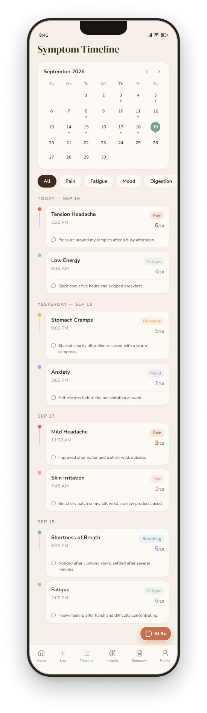
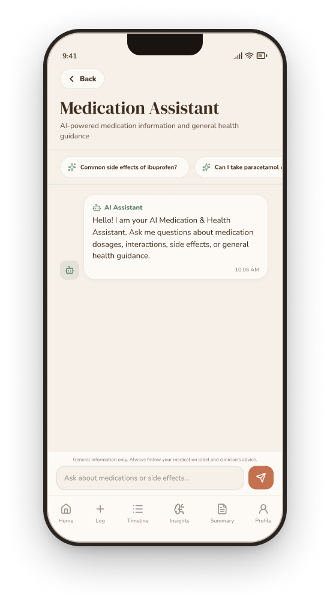
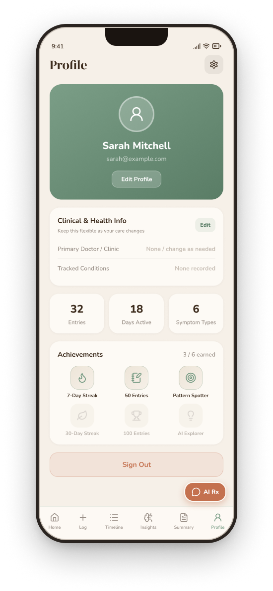

# SymptomJournal 🌿
> *"Log it calmly. Understand it clearly. Talk to your doctor with confidence."*

[](https://github.com/FrancoisleRouxDev/SymptomJournal/releases)
[](frontend/src/__tests__)
[-000020?style=for-the-badge&logo=expo)](https://expo.dev)
[](https://symptomjournal.onrender.com/docs)
[](https://supabase.com)
[]()

A cross-platform mobile health companion designed to replace the anxiety of Googling symptoms with calm, structured self-awareness. Users log physical and emotional symptoms in seconds, discover AI-powered temporal correlations, and export clinical SBAR doctor summaries to PDF — all wrapped in a warm, accessible interface.

---

## 📱 App Screens

<p align="center">
  
  
  
  
  
</p>

<p align="center">
  <em>Onboarding &nbsp;•&nbsp; Home Dashboard &nbsp;•&nbsp; Symptom Logger &nbsp;•&nbsp; AI Insights &nbsp;•&nbsp; Doctor Summary</em>
</p>

---

## Quick Links & Live Deployments

| Resource | Link | Description |
|:---|:---|:---|
| **GitHub Releases (v1.0.3)** | [**SymptomJournal Releases**](https://github.com/FrancoisleRouxDev/SymptomJournal/releases) | Latest release notes, changelog, and standalone build binaries |
| **Android APK Build** | [**Download APK (v1.0.3)**](https://github.com/FrancoisleRouxDev/SymptomJournal/releases) | Standalone installable Android build with brand icons & splash |
| **iOS Simulator Build** | [**iOS Simulator (.tar.gz)**](https://expo.dev/artifacts/eas/evplY85VchJ5j7K3TtDT6uXIu1fE2h_BfyZBJYh9l9s.tar.gz) | Apple iOS Simulator build for Appetize.io or Xcode Simulator |
| **Cloud API (Production)** | [**symptomjournal.onrender.com**](https://symptomjournal.onrender.com) | Production FastAPI backend hosted on Render |
| **Interactive API Docs** | [**Swagger UI Documentation**](https://symptomjournal.onrender.com/docs) | Interactive OpenAPI testing console with auth & analysis routes |
| **Presentation Script** | [**Presentation Script**](docs/MILESTONE_2_PRESENTATION_SCRIPT.md) | Demo walkthrough & rubric defense |
| **Technical Documentation** | [**Technical Report**](docs/MILESTONE_2_DOCUMENTATION.md) | In-depth architecture, data schemas, and risk mitigation |

---

## System Architecture

```
┌────────────────────────────────────────────────────────┐
│             React Native (Expo SDK 57)                 │
│   • Expo Router (Tabs & Stacks)   • Lucide Icons       │
│   • Light & Dark Theme System     • Dynamic Text Scale │
│   • Custom Triggers & Body Areas  • Print / PDF Export │
│   • Persistent Session (AsyncStorage + AppState)       │
└───────────┬────────────────────────────────┬───────────┘
            │                                │
      Supabase Auth                     JWT Bearer Auth
     (ES256 / HS256)                   (Axios Interceptor)
            │                                │
            ▼                                ▼
┌───────────────────────┐        ┌───────────────────────┐
│  Supabase PostgreSQL  │        │   FastAPI (Python)    │
│  • users              │◄───────┤   • /symptoms         │
│  • symptom_logs       │ (CRUD) │   • /analysis         │
│  • Row-Level Security │        │   • /auth (Swagger)   │
└───────────────────────┘        └───────────┬───────────┘
                                             │
                                     Secure Server Key
                                             ▼
                                 ┌───────────────────────┐
                                 │      NVIDIA NIM       │
                                 │  Llama 3.3 70B / 3.2  │
                                 │  • Pattern Discovery  │
                                 │  • Clinical SBAR Summ │
                                 │  • Safe Rx Assistant  │
                                 └───────────────────────┘
```

---

## Core Feature Highlights

### 1. Granular Symptom Logging & Customization

<p align="center">
  
</p>

* **Rapid 15-second entry:** 6 core categories (*Pain, Fatigue, Mood, Digestion, Breathing, Skin*) with specialized subcategories and emoji cues.
* **1–10 Severity & Onset:** Precise sliders with visual colour transitions and time presets (*Now, 1h ago, 3h ago, Earlier*).
* **Custom Anatomical Areas:** Add custom body areas grouped under intuitive parent regions (*Head, Neck, Chest, Abdomen, Back, Arms, Legs, General*).
* **Custom Lifestyle Triggers:** Create and save personal triggers (*e.g., "Screen Glare", "Dehydration", "Late Coffee"*) with local persistence.

---

### 2. Symptom Timeline & History

<p align="center">
  
</p>

* **Calendar dot indicators** show every day a log was recorded at a glance.
* **Category filter badges** let you quickly isolate Pain, Fatigue, Mood, Digestion, and more.
* **Chronological entry cards** show category, time, severity score, and your notes in a single tap.

---

### 3. AI Pattern Recognition & Insights

<p align="center">
  
</p>

* **Multi-Entry Synthesis:** Automatically evaluates trends once ≥ 3 logs are recorded.
* **Weekly Overview Chart:** Dual-series bar chart plotting Pain vs. Fatigue day-by-day.
* **Key Findings cards:** Sleep connections, afternoon peaks, week-over-week trend deltas — surfaced in plain language.
* **AI Recommendation:** A personalised lifestyle nudge based on your full history.
* **Zero Jitter:** Shimmer skeleton loaders provide smooth transitions during inference.

---

### 4. Clinical Doctor Summary & PDF Export

<p align="center">
  
</p>

* **SBAR Format:** Formats logged history into a physician-aligned brief (*Situation, Background, Assessment, Recommendation*).
* **Most Frequent Symptoms:** Colour-coded frequency bars with occurrence counts.
* **Patterns & Notes:** AI-synthesised bullet summaries of temporal and trigger patterns.
* **Questions to Discuss:** Ready-made conversation starters for your appointment.
* **One-tap Export PDF:** Publication-grade print layout via `expo-print` and `expo-sharing`.

---

### 5. AI Medication & Health Assistant

<p align="center">
  
</p>

* **Safe Clinical Guardrails:** Conversational assistant answering questions about over-the-counter medications, interactions, and symptom management.
* **Quick-Question Chips:** Tap pre-built prompts to get started instantly.
* **Strict Non-Diagnostic Disclaimer:** Explicit inline reminders ensuring users consult their physician or pharmacist for medical treatment.

---

### 6. Home Dashboard & Wellness Score

<p align="center">
  
</p>

* **Today's Wellness Score:** A 0–100 composite metric derived from recent severity entries and logging consistency.
* **Quick Stats:** Day Streak, Logged Today, and This Month counts at a glance.
* **Recent Symptoms feed** shows the last three entries with severity badges.
* **AI Insight nudge card** surfaces when a new pattern has been detected.

---

### 7. User Profile & Physician Details

<p align="center">
  
</p>

* **Editable Doctor Details (Optional):** Track your attending physician and clinic — or leave it blank if your care changes.
* **Health Statistics:** Total entries, days active, and distinct symptom types tracked.
* **Achievements System:** Earn badges for logging streaks, entry milestones, and using AI features.
* **Dark / Light Mode Toggle:** Accessible directly from the Profile screen.

---

### 8. Complete Dark & Light Mode System
* **Bespoke Palette:** Calming warm linen light canvas (`#F6F0E8`) and deep slate dark canvas (`#1C1917`), sage accents (`#7B9E87`), and terracotta highlights (`#C4714F`).
* **Instant Toggle:** Accessible via the Profile screen or inside Settings, automatically updating all tabs, modals, and navigation stacks.

### 9. Accessibility & Dynamic Text Scaling
* **User-Selectable Sizing:** Choose between *Small (85%)*, *Medium (100%)*, *Large (115%)*, and *Extra Large (130%)*.
* **Global Font Scaling:** Scales headings, body text, badges, and button labels dynamically for maximum legibility.

---

## Design System & Brand Identity

The interface balances medical clarity with calming organic aesthetics:

| Token | Light Theme | Dark Theme | Purpose |
|:---|:---|:---|:---|
| **Canvas** | `#F6F0E8` (Warm Linen) | `#1C1917` (Deep Slate) | Screen background |
| **Card / Surface** | `#FDFAF5` (Off-white) | `#292524` (Muted Slate) | Elevated containers & cards |
| **Primary Accent** | `#5A7D66` (Sage Dark) | `#8BAE97` (Sage Glow) | Active buttons, tabs & badges |
| **Secondary Accent**| `#C4714F` (Terracotta) | `#D97A5C` (Warm Rust) | High-severity indicators |
| **Headings** | `#3E2D1E` (Deep Bark) | `#F6F0E8` (Ivory Soft) | DM Serif Display headers |
| **Body Text** | `#6A5A4E` (Muted Soil) | `#C8BFB5` (Warm Grey) | Nunito regular / medium text |
| **Borders** | `#C8BFB5` | `#44403C` | Structural dividers & chip outlines |

---

## Testing & Verification

SymptomJournal enforces automated test coverage across both frontend and backend layers:

### Frontend Unit & Integration Tests (Jest)
```powershell
cd frontend
npm test
```
* **57 Tests Passing** across 8 test suites:
  * `auth.test.ts` — Session recovery, authentication flows, and profile updates.
  * `api.test.ts` — Axios interceptors, JWT attachment, and error handling.
  * `pdf-export.test.ts` — Clinical HTML generation, patient headers, and native share dialogs.
  * `SkeletonLoader.test.tsx` — Shimmer loading state animations across tab views.
  * `symptom-validation.test.ts` — Category bounds, severity constraints (1–10).
  * `theme.test.ts` — Semantic tokens, contrast levels, and theme provider state.
  * `components.test.tsx` — Custom typography and themed wrappers.
  * `onboarding.test.tsx` — Onboarding slide rendering with Lucide icon verification.

### Backend Unit & Integration Tests (pytest)
```powershell
cd backend
.\.venv\Scripts\pytest
```
* **49 Tests Passing** across 4 test suites:
  * `test_analysis.py` — SBAR summary generation, trend calculation, and pattern recognition.
  * `test_auth.py` — Supabase JWT verification (`ES256` / `HS256`) and profile auto-sync.
  * `test_symptoms.py` — Input validation (Pydantic constraints) and CRUD logic.
  * `test_ai_service.py` — LLM mocking, JSON fence stripping, and fallback recovery.

**Total Automated Coverage: 106 Passing Tests**

---

## Local Development Setup

### Prerequisites
* **Node.js** ≥ 18
* **Python** ≥ 3.11
* **Expo Go** on Android/iOS (or Android Emulator / iOS Simulator)

### 1. Clone Repository
```bash
git clone https://github.com/FrancoisleRouxDev/SymptomJournal.git
cd SymptomJournal
```

### 2. Backend Setup (FastAPI)
```bash
cd backend
python -m venv .venv
.\.venv\Scripts\activate   # On Linux/macOS: source .venv/bin/activate
pip install -r requirements.txt
uvicorn main:app --reload --port 8000
```
*Backend Swagger Docs accessible at: `http://localhost:8000/docs`*

### 3. Frontend Setup (React Native / Expo)
```bash
cd ../frontend
npm install
npm start
```
* Scan the terminal QR code with **Expo Go** (Android) or the **Camera app** (iOS).
* Press `w` to run on **Web** (supports Chrome Device Emulation).
* Press `a` to run on a connected **Android Emulator / Device**.

### 4. Cloud Builds (EAS)
```powershell
# Build standalone Android APK
npx eas-cli build -p android --profile preview

# Build iOS Simulator bundle (for Appetize.io or local Mac simulator)
npx eas-cli build -p ios --profile preview-simulator
```

---

## Project Roadmap & Status

- [X] **Phase 1 — Setup & Scaffolding** (Brand design tokens, typography, navigation skeleton)
- [X] **Phase 2 — Auth & Symptom Logging** (Supabase Auth, category grid, severity sliders)
- [X] **Phase 3 — AI Integration via FastAPI** (NVIDIA NIM, pattern detection, safety guardrails)
- [X] **Phase 4 — Core Features & Screens** (Timeline, Doctor Summary, Medication Chatbot, Profile)
- [X] **Phase 5 — Accessibility & Theming** (Complete Dark Mode, dynamic text sizing, custom triggers & body areas)
- [X] **Phase 6 — Clinical Export & Hardening** (Redesigned SBAR PDF, optional doctor info, 106 passing tests)
- [X] **Phase 7 — Multi-Platform Releases** (Render cloud backend, Android APK v1.0.3, iOS Simulator build)
- [ ] **Phase 8 — Qualitative User Testing** (5 peer usability evaluations & feedback analysis)

---

## Academic Module
**Module:** Interactive Development 300 (DV300) – Theme 4: AI-Driven Application  
**Institution:** The Open Window Institute  
**Student:** Francois le Roux (231256)  
**Milestone Date:** Wednesday, 14 October 2026 | **Final Submission:** 28 October 2026
