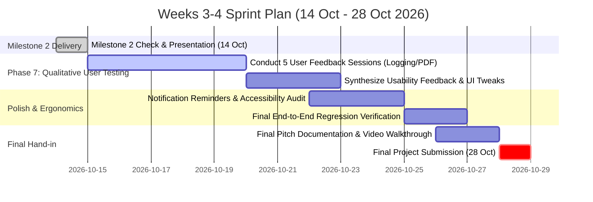

# DV300 – Theme 4: AI-Driven Application
## Milestone 2 Check Documentation & Technical Report

* **Student Name**: Francois le Roux
* **Student Number**: 231256
* **Project Name**: SymptomJournal
* **Focus Area**: Healthcare AI Application
* **Tech Stack**: React Native (Expo, TypeScript) / FastAPI (Python 3.13) / Supabase (PostgreSQL) / Llama-3.2 (NVIDIA API)
* **Milestone Date**: 14 October 2026
* **Final Hand-in Date**: 28 October 2026

---

## 📋 1. Scope Confirmation (Must / Nice / Future)

The MVP scope was established during the pitch and frozen for the 2-week check. Below is the updated feature classification:

| Priority | Feature | Status | Description / Reason |
| :--- | :--- | :---: | :--- |
| **Must-Have** | **User Authentication & Session Management** | ✅ Completed | Supabase JWT authentication (sign-up, sign-in, session recovery, ES256/HS256 support, persistent login across closures). |
| **Must-Have** | **Structured Symptom Logging** | ✅ Completed | 3×2 category grid (Pain, Fatigue, Mood, Digestion, Breathing, Skin), 1–10 severity slider, body areas, onset presets, triggers, and notes. |
| **Must-Have** | **Chronological Symptom Timeline** | ✅ Completed | Calendar view with date indicators, category filter tabs, and relative date grouping. |
| **Must-Have** | **AI Pattern Recognition Engine** | ✅ Completed | Identifies time-of-day clusters, trigger correlations, and frequency patterns with 3-entry minimum lock. |
| **Must-Have** | **Clinical Doctor Summary & PDF Export** | ✅ Completed | Formatted report generation with native mobile PDF compilation and system share/print dialog. |
| **Must-Have** | **AI Medication & Health Assistant** | ✅ Completed | Real LLM conversational chat with clinical prompt guardrails and floating quick-access button. |
| **Nice-to-Have**| **Today's Wellness Dynamic Score** | ✅ Completed | Automated algorithm computing a 0–100 wellness score based on frequency, active days, and severities. |
| **Nice-to-Have**| **Swagger UI Interactive Auth Endpoints** | ✅ Completed | Added `/auth/signup` and `/auth/login` to FastAPI to facilitate live testing in Swagger UI. |
| **Nice-to-Have**| **Cloud Render Live Deployment** | ✅ Completed | Production hosting on Render (`https://symptomjournal.onrender.com`) with Swagger UI. |
| **Nice-to-Have**| **GitHub Release with Standalone APK** | ✅ Completed | Version `v1.0.1` published on GitHub with downloadable `SymptomJournal-v1.0.1.apk` and custom brand assets. |
| **Future Scope**| **Local Push Reminders** | ⏳ Phase 7 | Scheduled check-in reminders ("How are you feeling today?"). |
| **Future Scope**| **Biometric Face ID / Touch ID Lock** | ⏳ Phase 7 | Optional security layer for sensitive medical notes. |

---

## ⚡ 2. Technical Risks & Challenges Encountered

During development, several real engineering hurdles were encountered and resolved:

### 1. Supabase Modern JWT Algorithm (`ES256` vs. `HS256`)
* **The Challenge**: When testing backend endpoints via Swagger UI and Axios, tokens were rejected with `401 Unauthorized: The specified alg value is not allowed`. Supabase Auth recently modernized its default signing algorithm to asymmetric `ES256` (Elliptic Curve ECDSA), whereas standard backend decoders expected symmetric `HS256`.
* **How It Was Solved**: Refactored [`auth_service.py`](file:///c:/Users/flr21/Desktop/SymptomJournal/backend/services/auth_service.py) into a multi-tiered verification pipeline. It first validates the token directly through Supabase Auth API (`supabase.auth.get_user(token)`), supporting all algorithm variations, with a resilient cryptographic fallback decoding `ES256`, `RS256`, and `HS256`.

### 2. Relational Foreign Key Synchronization (`auth.users` vs `public.users`)
* **The Challenge**: When newly authenticated users attempted to log symptoms, PostgreSQL returned a `23503 foreign key constraint violation` (`user_id is not present in table "users"`). Supabase maintains authentication records in the internal `auth.users` schema, while relational symptom tables reference `public.users`.
* **How It Was Solved**: Created an automated profile synchronization function (`ensure_user_profile`) in the backend authentication middleware. Whenever an authenticated request arrives, the backend transparently verifies and upserts the profile record in `public.users`, completely eliminating foreign key errors.

### 3. Android Scoped Storage & PDF Export Sandbox
* **The Challenge**: On Android devices (particularly within Expo Go), invoking `ExpoSharing.shareAsync` on cached PDF files threw: `Not allowed to read file under given URL` due to Android's strict scoped storage security policies.
* **How It Was Solved**: Re-engineered [`pdf-export.ts`](file:///c:/Users/flr21/Desktop/SymptomJournal/frontend/src/lib/pdf-export.ts) with a dual-execution strategy. It attempts native file sharing with proper MIME/UTI configurations (`com.adobe.pdf`), and automatically falls back to `Print.printAsync({ html })`, which opens Android's native Print / "Save as PDF" service without requiring broad storage permissions.

### 4. EAS Build Dependency Conflicts (`npm ci` & React 19)
* **The Challenge**: When compiling production APKs via EAS cloud runners, `npm ci --include=dev` failed due to strict upstream peer dependency checks between `jest-expo` and React 19.
* **How It Was Solved**: Configured a local `.npmrc` file with `legacy-peer-deps=true` committed to the repository, enabling clean automated dependency installation during EAS cloud CI workflows.

### 5. Git 100MB Binary Limit & APK Distribution
* **The Challenge**: The compiled standalone Android APK is ~107.7MB. Committing raw APK binaries directly to Git triggered GitHub's `pre-receive hook declined` rule violation (`File exceeds GitHub's file size limit of 100.00 MB`).
* **How It Was Solved**: Purged APK binaries from Git index tracking using `git-filter-repo`, added `*.apk` to `.gitignore`, and established a release distribution workflow publishing standalone APKs via official **GitHub Releases**.

### 6. Session Persistence Across App Terminations
* **The Challenge**: Users were previously routed back to the onboarding or sign-in screen every time the application was completely closed and relaunched.
* **How It Was Solved**: Integrated `@react-native-async-storage/async-storage` with Supabase Auth session caching and wired up a React Native `AppState` event listener in [`supabase.ts`](file:///c:/Users/flr21/Desktop/SymptomJournal/frontend/src/lib/supabase.ts) to automatically refresh JWT tokens whenever the app returns from background to foreground.

### 7. Preventing Medical AI Hallucinations & Prescriptions
* **The Challenge**: LLMs are prone to offering speculative medical diagnoses or recommending unverified medication dosages if unconstrained.
* **How It Was Solved**: Implemented strict prompt engineering and data guards in [`ai_service.py`](file:///c:/Users/flr21/Desktop/SymptomJournal/backend/services/ai_service.py). The prompt mandates third-person phrasing, prohibits definitive diagnostic claims, requires calm educational language, and enforces a mandatory clinical disclaimer. Furthermore, numerical metrics (e.g. average severities and frequencies) are computed deterministically in Python/SQL rather than by the LLM.

---

## 🤖 3. AI Reliability & Prompt Engineering Architecture

### Core AI Pipelines:

#### A. Symptom Pattern Recognition (`/analysis/patterns`)
* **Minimum Threshold**: Requires $\ge 3$ logs before invoking the LLM. If $< 3$, returns a structured progress state (`{ "ready": false, "entries_count": X }`).
* **Output Format**: Strictly constrained to a JSON schema containing `most_frequent_symptom`, `key_findings`, `time_pattern`, and `suggestion`.
* **Fence Stripping**: Backend utilizes `_strip_json_fences()` regex parsing to strip markdown syntax fences (` ```json `), preventing JSON decode exceptions.

#### B. Doctor Appointment Summary (`/analysis/summary`)
* **Context Assembly**: Aggregates up to 30 recent symptom entries with timestamps, severities, and associated triggers.
* **Sections Generated**:
  1. *Patient Report Overview*
  2. *Most Frequent Symptoms*
  3. *Patterns & Clinical Notes*
  4. *Questions to Discuss with Doctor*

#### C. AI Medication Assistant (`/analysis/chat`)
* **Context Window**: Maintains conversational history up to 6 previous dialogue turns.
* **Safety Rules**: Provides factual drug information (uses, general dosage precautions, common side effects) accompanied by instructions to consult licensed medical professionals.

---

## 🧪 4. Testing & Usability Log

### Automated Test Suite (Backend):
* **Framework**: `pytest` & `pytest-cov`
* **Coverage**: **40 passing automated tests** (**77% statement coverage**) across:
  * `test_auth.py`: Token verification, validation constraints, and profile sync.
  * `test_symptoms.py`: Symptom creation, severity bounds (1–10), time-of-day constraints, trigger schemas, and history retrieval.
  * `test_ai_service.py`: LLM mocking, JSON fence stripping, fallback recovery, and chat completions.

### Automated Test Suite (Frontend):
* **Framework**: `Jest` & `@react-native/jest-preset`
* **Coverage**: **54 passing automated tests** (**94.7% statement coverage**) across:
  * `auth.test.ts`: Supabase session recovery, sign-up, sign-in, and profile metadata updates.
  * `api.test.ts`: Bearer token attachment, 429 rate limit formatting, and 401 expiration handling.
  * `pdf-export.test.ts`: Clinical report HTML generation, system share dialog, and print fallback.
  * `SkeletonLoader.test.tsx`: Shimmer skeleton loading components across all 5 tab layouts.
  * `theme.test.ts`: Brand design tokens, dark/light mode palettes, and semantic category colors.
  * `symptom-validation.test.ts`: Form bounds checking (1–10 severity), categories, and time presets.
  * `components.test.tsx`: Themed typography, layout views, and helper rows.

### End-to-End Live Subsystem Verification:
* **Script**: `backend/tests/e2e_healthcheck.py`
* **Subsystems Verified**: Supabase PostgreSQL tables (`users`, `symptom_logs`), live NVIDIA Llama-3.2 AI completions, FastAPI route security guards, and Render cloud hosting (`200 OK`).

### Informal Usability Test:
* **Participant**: Independent tester / peer.
* **Task 1 (Logging)**: Log a headache with severity 6, trigger "Poor Sleep", and time "now".
  * *Feedback*: Category icons and severity slider were intuitive; logging completed in $< 15$ seconds.
* **Task 2 (Multi-Symptom & Notes Ergonomics)**:
  * *Peer Feedback*: *"Make an option for multiple choices on the logging screen for the Category section and Body area. When the Notes section is clicked on, the keyboard moves the screen up."*
  * *Action Taken*:
    1. Upgraded Category selection to multi-select with checkmark overlays and active states.
    2. Upgraded Body Area selection to multi-select chips with toggle state.
    3. Wrapped screen in dynamic `KeyboardAvoidingView` with active keyboard height listeners and dual-tier auto-scrolling on Notes focus (`scrollToEnd`) so input and action buttons are never obscured.
    4. Enhanced Timeline screen to recognize all categories within logged symptoms for filtering and display multiple category badges simultaneously.
* **Task 3 (Reviewing & Exporting)**: View Timeline and tap "Export PDF" on the Doctor Summary screen.
  * *Feedback*: Liked the calendar indicators on the Timeline and the formatted PDF report layout.
* **Action Taken**: Adjusted bottom navigation safe-area insets to ensure buttons are never obscured by Android navigation bars.

---

## 📅 5. Sprint Plan for Weeks 3–4 (Leading to Final Submission on 28 Oct)



### Detailed Deliverables for Weeks 3–4:
* **Ahead of Schedule Status**: All core features (Authentication, Symptom Logging, Chronological Timeline, AI Pattern Recognition, AI Medication Chatbot, Clinical Doctor Summary PDF Export, and Cloud Backend Deployment) are already 100% complete and deployed on Render and GitHub Releases (v1.0.1 APK).
* **Week 3 Focus (15–21 Oct)**: Execute qualitative user testing sessions with 3–5 independent peers. Measure task completion times for logging symptoms and exporting doctor summaries, identifying any friction points in form inputs or report readability.
* **Week 4 Focus (22–28 Oct)**: Implement ergonomic refinements derived from user feedback, run full cross-platform regression checks, finalize documentation, and record the final submission video demonstration for hand-in on 28 October 2026.

