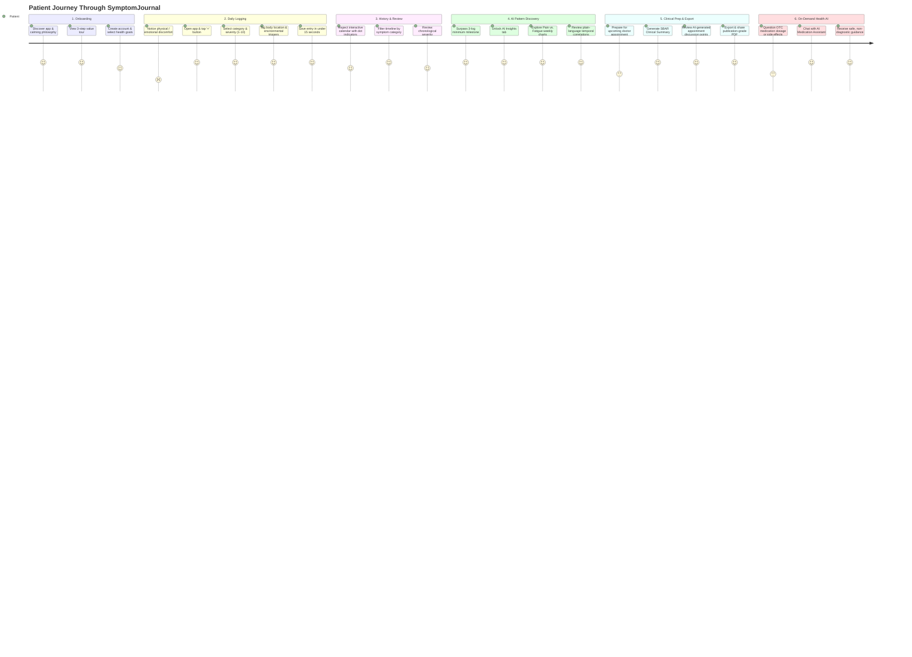
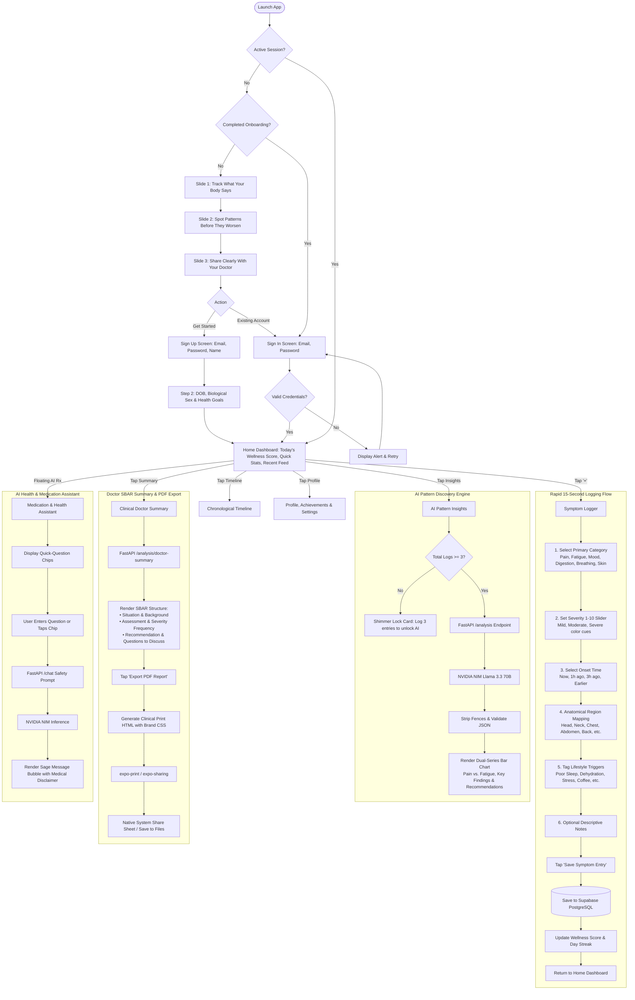

# SymptomJournal 🌿 – User Journey & Patient Experience Map

> *"From uncertainty to clarity: how patients navigate symptoms, uncover AI-driven insights, and communicate effectively with their healthcare providers."*

---

## 🗺️ Executive Summary: The Patient Lifecycle

Living with chronic, fluctuating, or mysterious symptoms often leads to anxiety, forgotten details during short 15-minute clinical appointments, and unhelpful internet searches. **SymptomJournal** bridges the gap between daily lived experience and clinical consultations through an intentional 6-stage user journey:

  

---

## 🔄 Detailed Step-by-Step User Flow

---

## 👥 Personas & Clinical Use Cases

### Persona 1: Sarah – Chronic Migraine Tracker
* **Background:** 28-year-old software designer experiencing recurring tension headaches and brain fog.
* **Core Pain Point:** In consultations, she forgets whether headaches happen before or after poor sleep.
* **SymptomJournal Journey:**
  1. Sarah logs each headache in 15 seconds from her phone's home screen.
  2. She tags triggers: *"Screen Glare"* and *"Poor Sleep"*.
  3. After 10 entries, the **AI Insights Engine** highlights: *"Headaches occur 85% more often following fewer than 5 hours of sleep."*
  4. Before her neurology visit, she taps **Export PDF** to hand her doctor a clean, 1-page SBAR clinical summary.

### Persona 2: Marcus – Adult Asthma & Breathing Flare-ups
* **Background:** 42-year-old runner diagnosed with adult-onset asthma.
* **Core Pain Point:** Needs to know if cold weather or pollen causes his chest tightness.
* **SymptomJournal Journey:**
  1. Marcus creates custom triggers: *"Cold Weather"* and *"High Pollen"*.
  2. Uses the **Medication Assistant** to ask *"Can I use my albuterol inhaler 15 minutes before running?"*
  3. Receives clear, safe non-diagnostic guidance reinforcing his prescription instructions.
  4. Filters the **Timeline Screen** by *"Breathing"* to see month-over-month improvements.

---

## 🛡️ Clinical Safety & Ethics Framework

| Guardrail Layer | Implementation | Purpose |
|:---|:---|:---|
| **Non-Diagnostic Policy** | Embedded system prompt & UI disclaimers | Ensures patients understand the app is for observation, not emergency diagnosis. |
| **Emergency Redirection** | Regex detection for red-flag symptoms (*chest pain, severe bleeding, anaphylaxis*) | Prompts users immediately to call local emergency services (e.g., 911 / 112). |
| **Data Privacy (HIPAA / GDPR)** | Supabase Row-Level Security (RLS) & JWT authentication | Each patient can only read, write, and export their own symptom logs. |
| **Optional Clinician Details** | Profile doctor fields are non-mandatory | Supports patients without a regular primary physician or those transitioning clinics. |

---

  Documented for DV300 Theme 4 (AI-Driven Application) • The Open Window Institute

